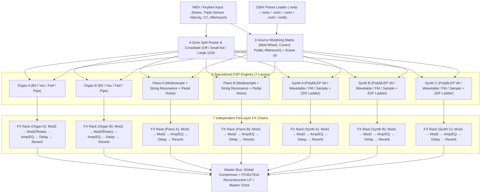

# Architecture

## 1. System Overview

The Nord Stage 4 hardware divides its workload between an **`ARM0`** host controller (keybed scanning, triple-sensor velocity calculation, OLED UI, USB/MIDI, program storage, and the 3-source Morphing Matrix) and multiple Analog Devices SHARC floating-point DSPs (**`DSPO`** for Organ physical modeling, **`DSPS`** for the 3-layer Wave 2 Synth engine, and **`DSPF`** for Piano resonance and the 7 per-layer FX pipelines).

Our emulator mirrors this exact modular separation in a deterministic, real-time safe Rust workspace (`crates/nord-core`) paired with a Python analysis & inspection suite (`tools/`).



---

## 2. Repository Layout

```text
nord-stage-4-emulator/
├── Cargo.toml                  # Rust workspace manifest
├── pyproject.toml              # Python (uv / ruff / pytest) configuration
├── AGENTS.md                   # Canonical instructions for AI coding agents
├── CLAUDE.md                   # Entry point pointing to AGENTS.md & .agents/rules/
├── .beans.yml                  # Beans task tracker configuration (prefix: ns4-)
├── .beans/                     # Tracked task & epic beans
├── .agents/
│   ├── rules/                  # Project rules (docs, testing, DSP, evidence, git)
│   └── skills/                 # Reusable agent workflows
├── crates/
│   └── nord-core/              # Pure Rust DSP + CBIN/Firmware parser + CLI
│       ├── Cargo.toml
│       └── src/
│           ├── lib.rs          # Crate root & public exports
│           ├── cbin.rs         # Clavia Binary (CBIN) & .ns4b parser/serializer
│           ├── firmware.rs     # OS v1.66 firmware container & SHARC partition parser
│           ├── morph.rs        # 3-source Morph matrix, Scene I/II, 4-zone split crossfade
│           ├── organ.rs        # B3 91-tonewheel physical model, percussion & Rotary 122
│           ├── piano.rs        # Piano multisample voice, timbre EQ & modal string resonance
│           ├── synth.rs        # Wave 2 PolyBLEP VA osc, ZDF Ladder filter & ADR envelope
│           ├── fx.rs           # Per-layer 5-slot FX pipeline + Master Compressor & Clock
│           ├── midi.rs         # Nord Stage 4 MIDI CC map & message router
│           ├── engine.rs       # 7-layer multitimbral Stage4Engine coordinator
│           └── bin/
│               └── ns4.rs      # CLI binary for preset/backup inspection & offline render
├── tools/
│   ├── check_tests.py          # CI ratchet ensuring every source file has unit tests
│   ├── ns4_inspect.py          # Python CBIN / .ns4b / firmware analysis toolkit
│   ├── test-baseline.txt       # Ratchet baseline (0 uncovered files)
│   └── tests/                  # Pytest suite covering all Python tools
└── docs/
    ├── PRD.md
    ├── ROADMAP.md
    ├── ARCHITECTURE.md
    ├── DECISIONS.md
    ├── OPEN-QUESTIONS.md
    ├── GLOSSARY.md
    ├── specs/                  # Subsystem technical specifications
    └── research/               # Reverse-engineering & hardware teardown reports
```

---

## 3. Real-Time DSP Invariants

1. **Zero Heap Allocations in `process_block()`:** All delay lines, tonewheel phase accumulators, modal resonator states, and voice pools are pre-allocated at engine initialization (`Stage4Engine::new(sample_rate)`).
2. **Deterministic Offline Rendering:** Given an identical sample rate, preset state, and sequence of timestamped MIDI events, `Stage4Engine` produces bit-identical floating-point audio frames across runs.
3. **Sample-Accurate Master Clock:** A single `MasterClock` (BPM `30.0..=300.0`) drives Synth arpeggiators, LFO sync divisions,Modulation effects, and Ping-Pong Delay tap times across all 7 layers.
4. **Hardware-Matched Output Stage:** A gentle 1st-order reconstruction filter models the post-DAC analog stage (`CS4392` + `LM833`/`LF353` active low-pass at 42 kHz) to prevent ultrasonic intermodulation at high sample rates.
