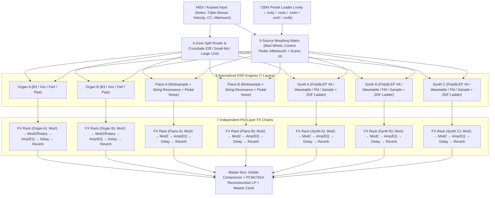

# Architecture

## 1. System Overview

The Nord Stage 4 hardware divides its workload between an **`ARM0`** host controller (keybed scanning, triple-sensor velocity calculation, OLED UI, USB/MIDI, program storage, and the 3-source Morphing Matrix) and multiple Analog Devices SHARC floating-point DSPs (**`DSPO`** for Organ physical modeling, **`DSPS`** for the 3-layer Wave 2 Synth engine, and **`DSPF`** for Piano resonance and the 7 per-layer FX pipelines).

Our emulator mirrors this exact modular separation in a deterministic, real-time safe Rust workspace (`crates/nord-core`) paired with a Python analysis & inspection suite (`tools/`).



---

## 2. Repository Layout

```text
nord-stage-4-emulator/
├── Cargo.toml                  # Rust workspace manifest
├── pyproject.toml              # Python (uv / ruff / pytest) configuration
├── AGENTS.md                   # Canonical instructions for AI coding agents
├── CLAUDE.md                   # Entry point pointing to AGENTS.md & .agents/rules/
├── .beans.yml                  # Beans task tracker configuration (prefix: ns4-)
├── .beans/                     # Tracked task & epic beans
├── .agents/
│   ├── rules/                  # Project rules (docs, testing, DSP, evidence, git)
│   └── skills/                 # Reusable agent workflows
├── crates/
│   ├── nord-core/              # Pure Rust DSP + CBIN/Firmware parser + CLI (`ns4`)
│   │   └── src/
│   │       ├── lib.rs          # Crate root & public exports
│   │       ├── cbin/           # Clavia Binary (CBIN), .ns4b backup, presets, .npno / .nsmp4 sample decoders
│   │       ├── firmware/       # OS v1.66 container, Clavia LZO1X, SHARC partition parser
│   │       ├── morph.rs        # 3-source Morph matrix, Scene I/II, 4-zone split crossfade
│   │       ├── organ/          # Tonewheel sources (Legacy, firmware bank, B3Wheels), weights, vibrato, Rotary 122
│   │       ├── piano.rs, piano/# Multisample voice, timbre EQ, string resonance; SMP Q31 kernel, voice, Q32 step, Q23 level
│   │       ├── synth/, synth_*.rs # Wave 2 PolyBLEP VA, ZDF Ladder, ADR, arpeggiator, firmware saw, gain de-zipper
│   │       ├── sinc/, sinc.rs  # 12-tap x 256-phase Kaiser sinc kernels (SY1SY2 resampler parity)
│   │       ├── fx/             # Per-layer 5-slot FX pipeline, Master Compressor & Clock, `fw_*` firmware routine ports
│   │       ├── midi.rs         # Nord Stage 4 MIDI CC map & message router
│   │       ├── engine/         # 7-layer multitimbral Stage4Engine coordinator
│   │       ├── render.rs       # Offline MIDI-timeline renderer + 32-bit float WAV writer (A/B benchmark loop)
│   │       └── bin/ns4.rs      # CLI: preset/backup inspection, convert, render-patch
│   ├── nord-sharc/             # ADSP-2148x / 2157x (SHARC, SHARC+) VISA decoder + core model = test oracle (specs/sharc-core.md)
│   │   └── src/
│   │       ├── visa/           # Instruction decoder (types, classify, regs, compute)
│   │       ├── core/           # Registers, DAGs, loops, SIMD, float/fixed ALU, shifter, stacks, interrupts, timer
│   │       │   └── periph/     # SEC0, SPI2 peek port, descriptor DMA, TRU, LP1, L2, 2148x SPI-slave boot
│   │       ├── runner/, harness.rs # Shared pass, message and audio helpers for the binaries
│   │       └── bin/            # sharc-run, sharc-org, sharc-bank, sharc-organ, sharc-chain, sharc-pass, sharc-fx, sharc-ref, sharc-census-run, sharc-disasm
│   ├── nord-gui/               # Standalone egui app (Phase 6)
│   ├── nord-plugin/            # nih-plug CLAP / VST3 / Standalone wrapper
│   └── xtask/                  # Bundling tasks (nih_plug_xtask)
├── tools/
│   ├── check_tests.py          # CI ratchet ensuring every source file has unit tests
│   ├── ns4_inspect.py          # CBIN / .ns4b / firmware analysis toolkit; ns4_*.py: DSP image cutters, loaders, tables, cross-checks
│   ├── sharc_*.py, adi_*.py    # VISA decoder, census, routine I/O, ADI `elfdump` listing and comparison helpers
│   ├── arm_*.py                # ARM firmware emulation harness (`unicorn`): boot, steady state, capture, slot owners, organ and piano paths
│   ├── organ_*.py, pno_*.py    # Organ and PNO core 1 oracle drivers and reference models
│   ├── fx_*.py, synth_*.py     # FX and synth routine models, fits, symbolic extractors, stage oracles
│   ├── video_ref.py            # YouTube/local hardware video ROI, WAV & spectral comparator
│   ├── oracle_scenarios/       # Scenario files for `sharc-ref`
│   ├── test-baseline.txt       # Ratchet baseline (0 uncovered files)
│   └── tests/                  # Pytest suite covering all Python tools
└── docs/
    ├── PRD.md
    ├── ROADMAP.md
    ├── ARCHITECTURE.md
    ├── DECISIONS.md
    ├── OPEN-QUESTIONS.md
    ├── GLOSSARY.md
    ├── specs/                  # Subsystem technical specifications
    └── research/               # Reverse-engineering notes; `data/` (derived values only), `sharc-seq/` (simulator probes)
```

---

## 3. Real-Time DSP Invariants

1. **Zero Heap Allocations in `process_block()`:** All delay lines, tonewheel phase accumulators, modal resonator states, and voice pools are pre-allocated at engine initialization (`Stage4Engine::new(sample_rate)`).
2. **Deterministic Offline Rendering:** Given an identical sample rate, preset state, and sequence of timestamped MIDI events, `Stage4Engine` produces bit-identical floating-point audio frames across runs.
3. **Sample-Accurate Master Clock:** A single `MasterClock` (BPM `30.0..=300.0`) drives Synth arpeggiators, LFO sync divisions,Modulation effects, and Ping-Pong Delay tap times across all 7 layers.
4. **Hardware-Matched Output Stage:** A gentle 1st-order reconstruction filter models the post-DAC analog stage (`CS4392` + `LM833`/`LF353` active low-pass at 42 kHz) to prevent ultrasonic intermodulation at high sample rates.

---

## 4. SHARC Oracle and ARM Firmware Harness (Track B)

The runtime engine stays high-level ([D2](DECISIONS.md#d2-high-level-dsp-emulation-over-low-level-sharc-instruction-emulation)). Two research-time systems give it ground truth ([D18](DECISIONS.md#d18-rust-sharc-oracle-validated-against-the-adi-cycle-accurate-simulator), [D19](DECISIONS.md#d19-arm-firmware-emulation-harness-unicorn-as-the-parameter-stream-source)). Neither is linked into the plugin. Only derived values leave them ([D20](DECISIONS.md#d20-derived-values-only-no-firmware-bytes-in-the-repository)).

### 4.1 Data flow

```text
 local only (never committed)
 ----------------------------
 OS v1.66 update ──► firmware/ (LZO1X) ──► bank0_CODE.bin, bank0_SRAM.bin
                                              │
              ┌───────────────────────────────┴──────────────────────────┐
              ▼                                                          ▼
  tools/ns4_dsp_images.py, ns4_dsp_ldr.py --sram            tools/arm_emu.py (unicorn, ARM926EJ-S)
  5 DSP images: FX, PNO, ORG (2157x)                        tools/arm_boot*.py, arm_steady.py
                SY1SY2, SMP (2148x)                         boot to the main loop; edit ids through
              │                                             the real layer clients
              │                                                          │
              │                                   ARM -> DSP messages (target, address, value)
              │                                   tools/arm_capture.py, arm_edit_capture.py
              │                                                          │
              │                                   replay scripts (docs/research/data/*.script)
              ▼                                                          │
  crates/nord-sharc: core model + periph  ◄──────── --msg-script / --script
  sharc-org, sharc-chain, sharc-pass, sharc-organ, sharc-fx, sharc-ref
              │  oracle audio, DM/PM dumps
              ▼
  comparison with the nord-core render (tools/ns4_oracle_compare.py, nord-core examples)
              │
              ▼
  committed: VERIFIED / EMPIRICAL / ASSUMED tags, research notes, derived CSVs,
             opt-in firmware paths in nord-core (D22), golden tests, `render_hash`

  model vs reference:  nord-sharc  ◄── measured fixtures ──  ADI CCES simulator (headless TpsdkServer,
                                                             docs/research/sharc-seq/sim_run.py, local only)
```

### 4.2 Chips and images

| Image | Cores | Chip ([D17](DECISIONS.md#d17-chip-identity-fx-pno-and-org-run-on-adsp-2157x-sharc-sy1sy2-and-smp-on-adsp-2148x)) | Role |
|---|---|---|---|
| FX | 2 | ADSP-2157x (SHARC+) | Per-layer effects, compressor, reverb |
| PNO | 2 | ADSP-2157x | Core 1: organ generators, Pipe bank, mix, post and output stages, piano modules |
| ORG | 2 | ADSP-2157x | Channel strips, synth stages (Core 2 filter `0x12566E`), SPI2 peek port |
| SY1SY2 | 1 | ADSP-2148x | Synth sample voices, resampler |
| SMP | 1 | ADSP-2148x | Compressed `CNSP` piano voices |

### 4.3 Binaries (`crates/nord-sharc/src/bin/`)

| Binary | Purpose |
|---|---|
| `sharc-disasm` | VISA listing, identical to `tools/sharc_visa.py` |
| `sharc-run` | Run an image from an entry address with scripted device registers, pokes and interrupts |
| `sharc-census-run` | Model side of the census diff against the simulator |
| `sharc-org` | ORG Core2 processing passes with `--msg-script` replay |
| `sharc-bank` | PNO Core1 oscillator bank `0x122620` |
| `sharc-organ` | Bank, mix stage `0x12268F`, optional post stage `0x12272D` |
| `sharc-chain` | Any sequence of PNO Core1 routines (`--step ENTRY:RET`) |
| `sharc-pass` | Complete PNO core 1 pass (call table, 18-module chain, ping-pong buffers) |
| `sharc-fx` | One routine of the FX image |
| `sharc-ref` | Reference render of a scenario (SY1SY2 and SMP: command FIFO, audio ISR, WAV out) |

Specs and procedures: [sharc-core](specs/sharc-core.md), [oracle-vs-engine](research/oracle-vs-engine.md), [arm-fw-emulation](research/arm-fw-emulation.md).
